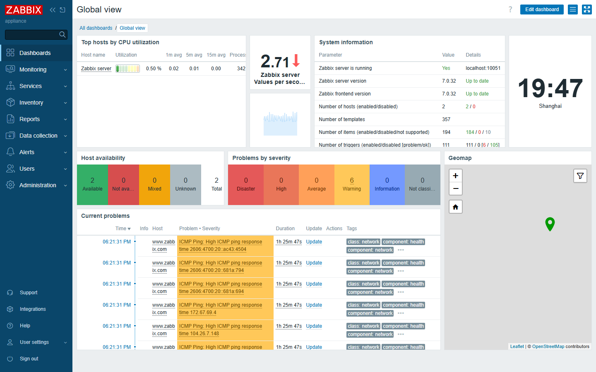
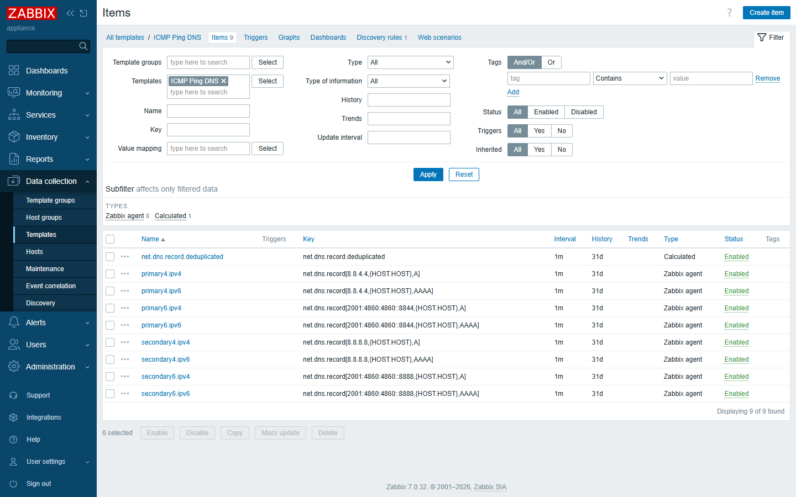
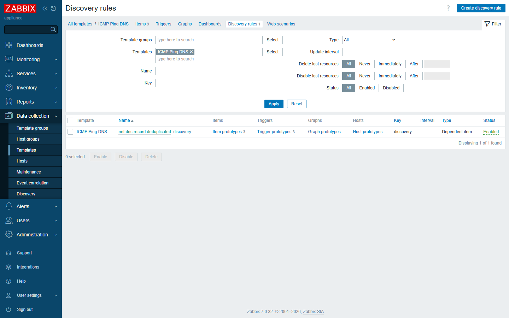
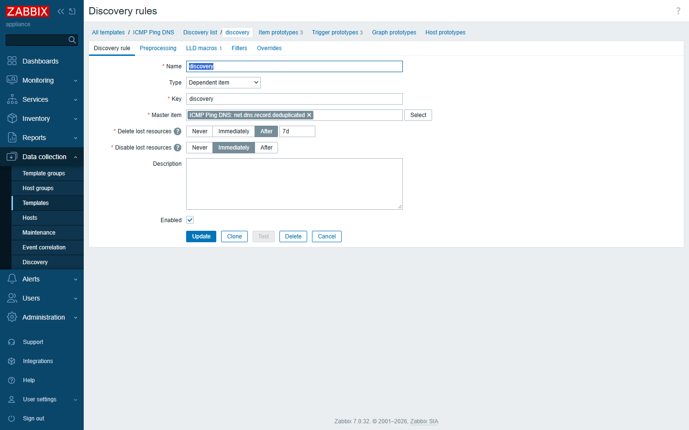
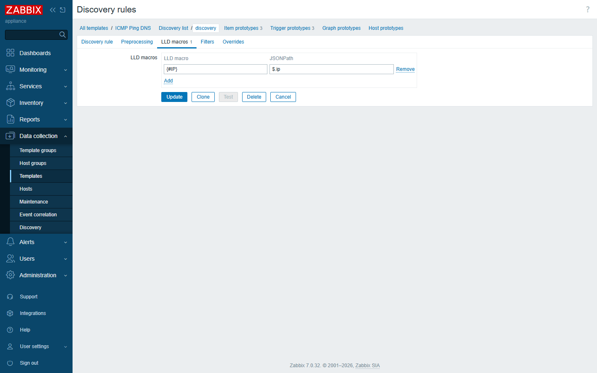
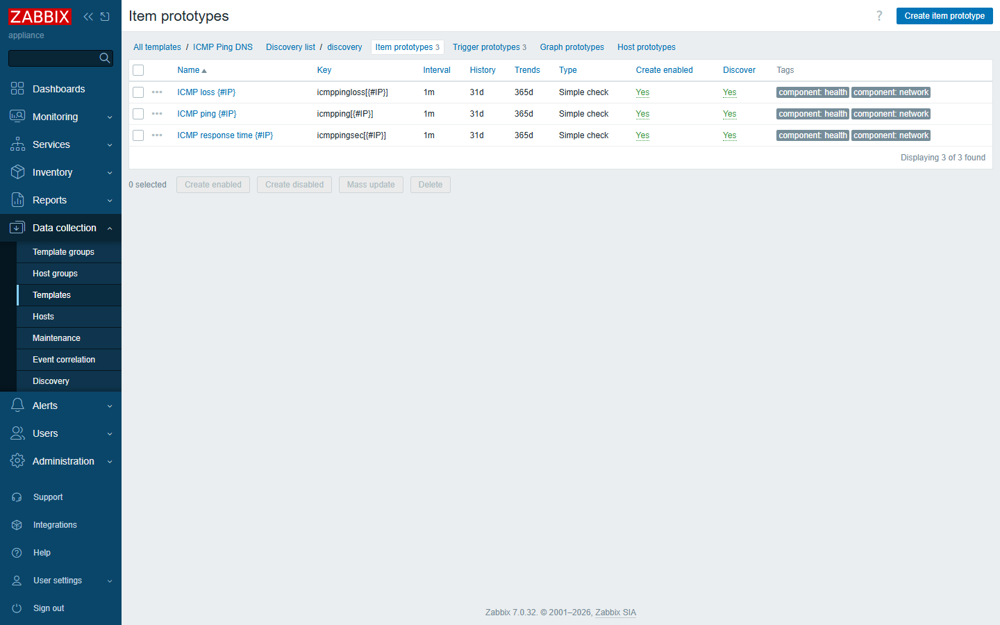
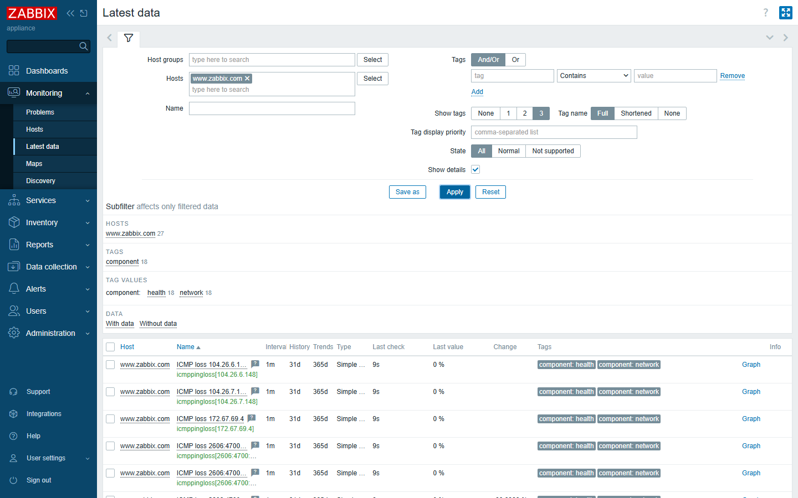
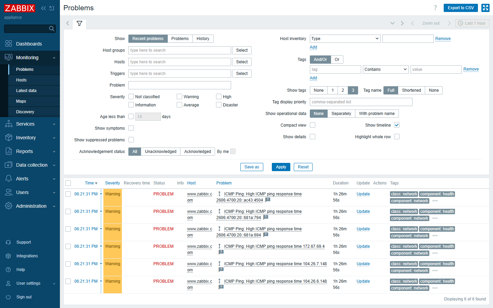
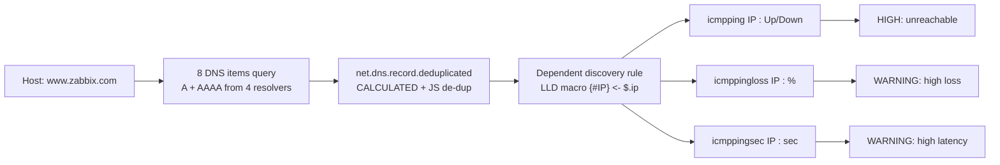

# 🌐 ICMP Ping DNS — DNS-Driven ICMP Monitoring Template for Zabbix

[](https://www.zabbix.com/)
[](LICENSE)
[]
[]()

> **Ping a hostname, not just one IP.**  
> Traditional ICMP templates hard-code a single IP — but modern services sit behind
> DNS round-robin, CDNs, anycast and dual-stack (IPv4 + IPv6). This template
> **resolves the hostname via multiple public DNS servers, discovers *every* IP it
> points to, and monitors each one independently** with availability, packet-loss
> and latency checks.

---

## 📸 Live screenshots (from a real Zabbix 7.0 server)

| Dashboard | Template items | DNS-driven discovery |
|---|---|---|
|  |  |  |

| Discovery rule (master item + LLD macro) | LLD macro `$.ip → {#IP}` | Item prototypes |
|---|---|---|
|  |  |  |

| Latest data — 6 discovered IPs | Live Problems (triggers firing) |
|---|---|
|  |  |

---

## 🤔 Why this template exists

Most "ICMP Ping" templates do this:

```
Host "example.com"  ──►  ping 93.184.216.34   (one IP, hard-coded or manual)
```

That works **until** the service is multi-homed:

- **CDN / Cloudflare / Akamai** — one domain → dozens of边缘节点 IPs.
- **DNS round-robin / load balancing** — the IP you resolve changes over time.
- **Anycast** — the "same" IP may route to different PoPs.
- **Dual-stack** — you must watch both IPv4 **and** IPv6.

If you only monitor *one* of those IPs, you get a false "everything is fine" when
in reality half the edge is unreachable. **`ICMP Ping DNS` fixes this by letting
DNS be the source of truth for *what* to monitor.**

---

## ✨ Features

- 🧭 **Automatic multi-IP discovery** — resolves the host against **4 public DNS
  resolvers** (Google DNS `8.8.4.4` / `8.8.8.8` and their IPv6 equivalents
  `2001:4860:4860::8844` / `::8888`), for both **A** and **AAAA** records.
- 🧹 **De-duplication** — collates the answers from all resolvers, removes
  duplicate IPs, and feeds a clean list into Low-Level Discovery (LLD).
- 🌍 **IPv4 + IPv6** — every discovered address (v4 and v6) gets its own items.
- 📡 **Per-IP monitoring** — for each discovered IP it creates:
  - **ICMP ping state** (`Up` / `Down`, via value map)
  - **Packet loss %**
  - **Response time (sec)**
- 🚨 **Tiered triggers** — `HIGH` when an IP is unreachable, `WARNING` on high
  loss / high latency, with proper **dependencies** so you don't get alert
  storms.
- 🎛️ **Tunable macros** — `{$ICMP_LOSS_WARN}` (default `20%`) and
  `{$ICMP_RESPONSE_TIME_WARN}` (default `0.15s`) — override per host/template.
- 🏷️ **Rich tagging** — `class:network`, `target:icmp`, `component:health/network`,
  `scope:availability/performance` for filtering & dashboards.
- 📦 **Import-ready** — ships as YAML, XML and JSON (Zabbix 7.0 export format).

---

## 🧩 How it works



1. **9 regular items** query DNS. Eight of them ask four public resolvers for the
   host's `A` and `AAAA` records (`net.dns.record[<resolver>,{HOST.HOST},<type>]`).
   A small JavaScript preprocessing step extracts just the IP addresses.
2. A **calculated item** `net.dns.record.deduplicated` concatenates all eight
   answers, then a JavaScript step parses and **removes duplicate IPs**.
3. A **dependent discovery rule** uses that de-duplicated list as its master item.
   The LLD macro `{#IP}` is mapped from the JSONPath `$.ip`, so **every unique IP
   becomes a discovered object**.
4. For each `{#IP}` Zabbix auto-creates the **three ICMP item prototypes** plus
   their **trigger prototypes**.

See [docs/implementation.md](docs/implementation.md) for the full, screenshot-by-screenshot breakdown.

---

## 🚀 Quick start

### Requirements
- Zabbix **server/proxy 7.0** (template is a 7.0 export).
- The Zabbix server (or the host's poller) must be able to **reach the public DNS
  resolvers** `8.8.4.4`, `8.8.8.8`, `2001:4860:4860::8844`, `2001:4860:4860::8888`
  and **perform ICMP** to the discovered IPs.
- `net.dns.record[...]` and `icmpping[...]` / `icmppingloss[...]` /
  `icmppingsec[...]` are built-in Zabbix item keys (no agent/UserParameter needed
  on the monitored host — ICMP & DNS are done by the Zabbix server/proxy).

### Import the template
1. Download `templates/ICMP Ping DNS.yaml` (or `.xml` / `.json`).
2. In Zabbix: **Configuration → Templates → Import** and upload the file.
3. The template `ICMP Ping DNS` appears under *Templates/Network devices*.

### Link it to a host
1. **Configuration → Hosts → your host → Templates** → link `ICMP Ping DNS`.
2. Make sure the host has at least one interface (the DNS name comes from
   `{HOST.HOST}`, so name the host by its domain, e.g. `www.zabbix.com`).
3. Wait a polling cycle — the discovery rule runs and **creates one set of ICMP
   items per resolved IP**.

That's it. Head to **Monitoring → Latest data** and watch every IP light up.

Full walkthrough with pictures: [docs/usage.md](docs/usage.md).

---

## 🌍 Real-world demo: `www.zabbix.com`

Bundled in [`examples/`](examples) is a host that links this template to
`www.zabbix.com`. On a live 7.0 server it resolved to **6 addresses** — three
IPv4 (Cloudflare `104.26.6.148`, `104.26.7.148`, `172.67.69.4`) and three IPv6
(`2606:4700:20::681a:694`, `::681a:794`, `::ac43:4504`). All six were monitored
automatically, and during the capture several triggered **high-latency warnings**
(175 ms / 183 ms) — something a single-IP ping check would have hidden.

See [docs/effects.md](docs/effects.md) for the captured evidence.

---

## 🚨 Triggers & alerting

| Trigger | Priority | Condition |
|---|---|---|
| `ICMP Ping: Unavailable by ICMP ping {#IP}` | **High** | last 3 checks = 0 (timeout) |
| `ICMP Ping: High ICMP ping loss {#IP}` | Warning | loss > `{$ICMP_LOSS_WARN}` and < 100% |
| `ICMP Ping: High ICMP ping response time {#IP}` | Warning | avg response > `{$ICMP_RESPONSE_TIME_WARN}` |

Trigger dependencies are wired so a fully-down IP only raises the *Unavailable*
alert, not three redundant ones.

---

## 📁 Repository layout

```
zabbix-icmp-ping-dns/
├── README.md                      # this file (English)
├── README.zh-CN.md                # 中文文档
├── LICENSE                        # GPL-2.0
├── CHANGELOG.md
├── CONTRIBUTING.md
├── templates/
│   ├── ICMP Ping DNS.yaml         # ← import this (Zabbix 7.0)
│   ├── ICMP Ping DNS.xml
│   └── ICMP Ping DNS.json
├── examples/
│   └── www.zabbix.com.*           # demo host (links the template)
└── docs/
    ├── implementation.md          # how it works, in detail
    ├── usage.md                   # step-by-step usage
    ├── effects.md                 # real demo results
    ├── GITHUB_UPLOAD_TUTORIAL.md  # how to publish this repo
    └── screenshots/               # all PNGs used above
```

---

## 🤝 Contributing

Pull requests are welcome! See [CONTRIBUTING.md](CONTRIBUTING.md). Ideas:
IPv6-only mode, custom resolver lists via macros, Grafana dashboard JSON, etc.

## 📜 License

[GPL-2.0-or-later](LICENSE). Zabbix templates traditionally live under the GPL,
which keeps them compatible with the Zabbix ecosystem.

---

⭐ If this template saves you a 3 a.m. page, give it a star!
