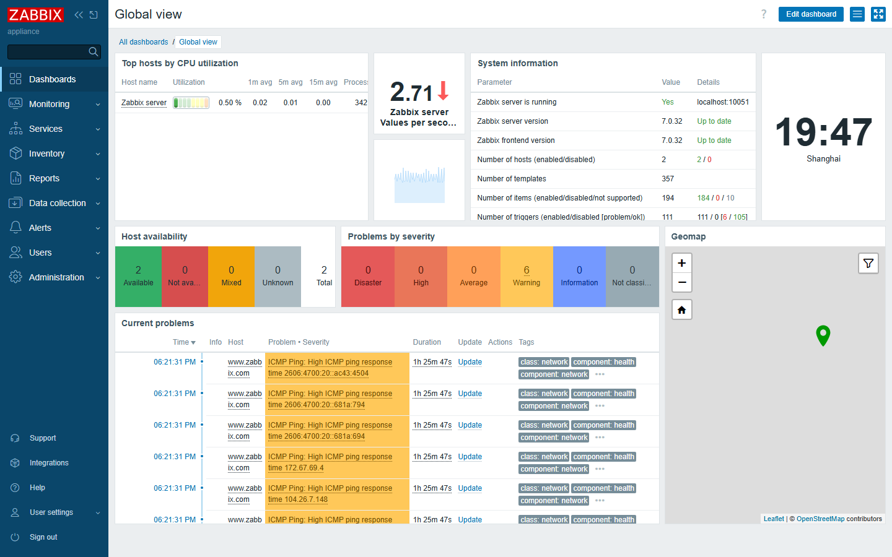
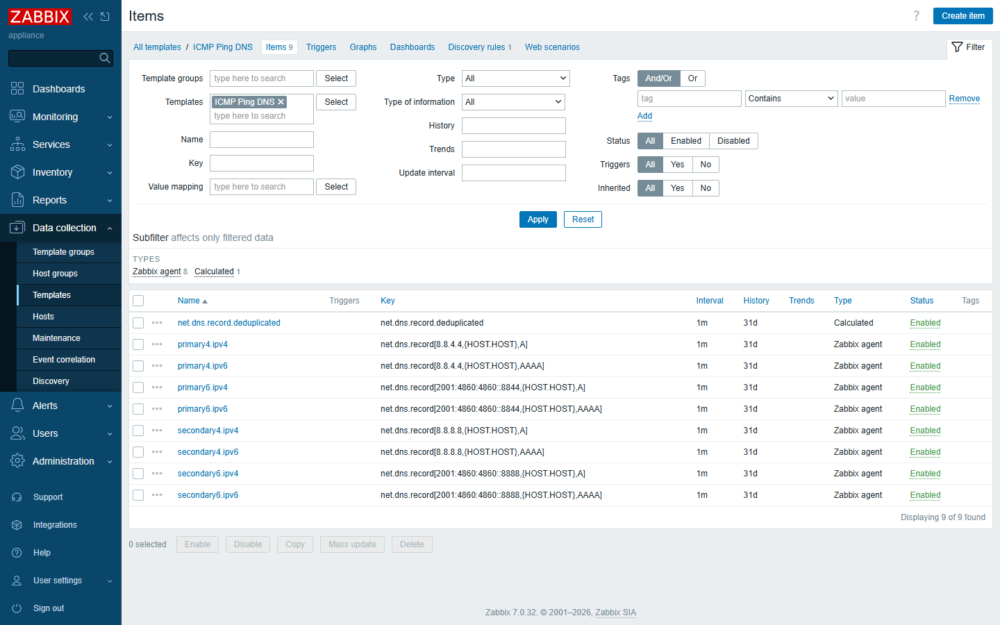
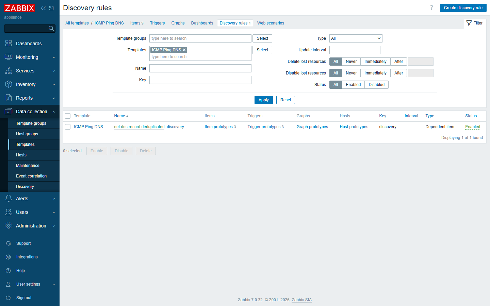
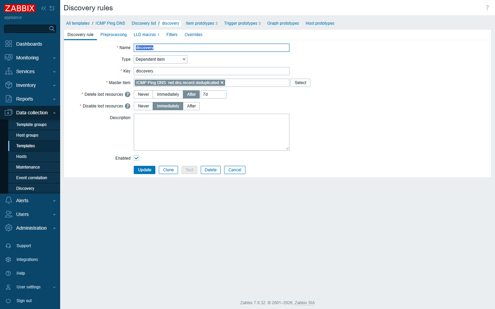
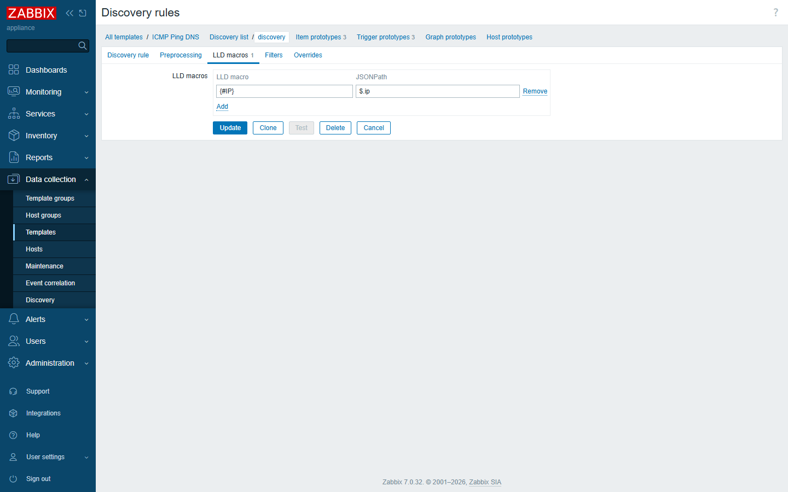
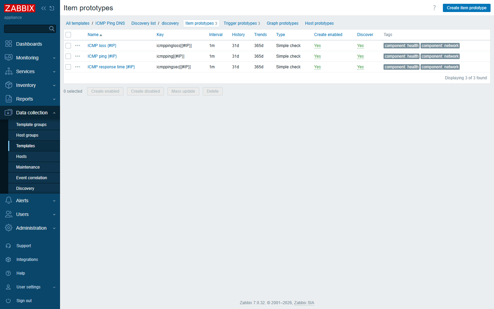
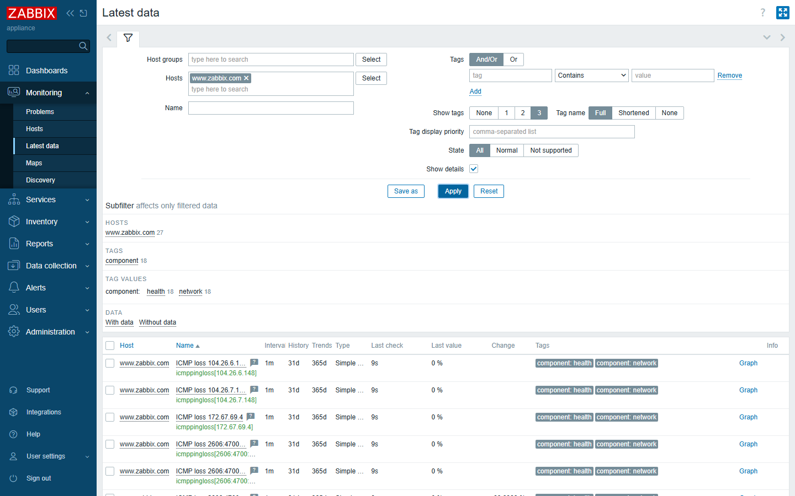
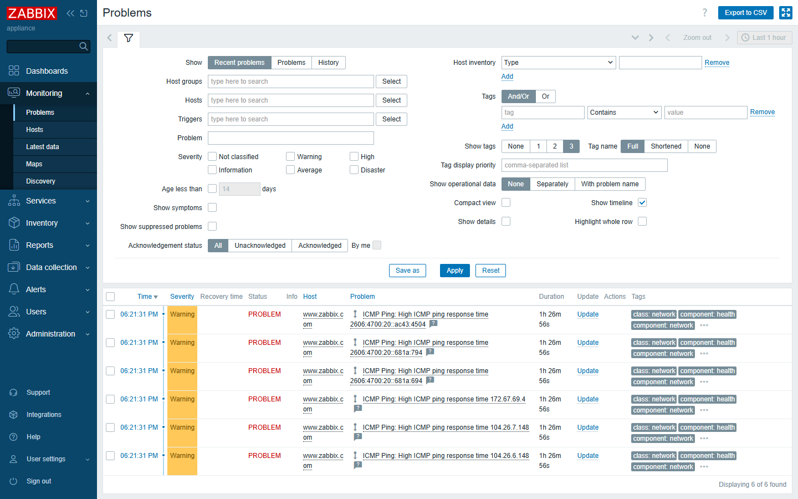
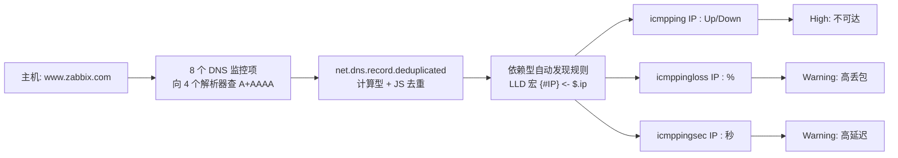

# 🌐 ICMP Ping DNS —— 基于 DNS 自动发现的 Zabbix ICMP 监控模板

[](https://www.zabbix.com/)
[](LICENSE)
[]()

> **Ping 的是一个域名，而不只是一个 IP。**  
> 传统的 ICMP 模板把 IP 写死，但现代服务普遍使用 DNS 轮询、CDN、Anycast 和双栈
> （IPv4 + IPv6）。本模板**通过多个公共 DNS 解析域名，自动发现它指向的每一个 IP，
> 并对每个 IP 独立做可用性、丢包率和延迟监控**。

---

## 📸 真实截图（来自一台真实的 Zabbix 7.0 服务器）

| 仪表盘 | 模板监控项 | 基于 DNS 的自动发现 |
|---|---|---|
|  |  |  |

| 自动发现规则（主监控项 + LLD 宏） | LLD 宏 `$.ip → {#IP}` | 监控项原型 |
|---|---|---|
|  |  |  |

| 最新数据 —— 自动发现的 6 个 IP | 实时问题（触发器已触发） |
|---|---|
|  |  |

---

## 🤔 为什么需要这个模板

大多数 “ICMP Ping” 模板是这样做的：

```
主机 "example.com"  ──►  ping 93.184.216.34   （一个写死的 IP）
```

一旦服务是多归属的，这就不够用了：

- **CDN / Cloudflare / Akamai** —— 一个域名对应几十个边缘节点 IP。
- **DNS 轮询 / 负载均衡** —— 你解析到的 IP 会随时间变化。
- **Anycast** —— “同一个” IP 可能路由到不同接入点。
- **双栈** —— 你必须同时关注 IPv4 **和** IPv6。

如果只监控其中**一个** IP，当另一半边缘节点不可达时，你会得到虚假的
“一切正常”。**`ICMP Ping DNS` 让 DNS 来告诉 Zabbix “该监控哪些 IP”**，从而解决这个问题。

---

## ✨ 功能特性

- 🧭 **多 IP 自动发现** —— 向 **4 个公共 DNS 解析器**（Google DNS `8.8.4.4` /
  `8.8.8.8` 及其 IPv6 `2001:4860:4860::8844` / `::8888`）查询主机的 **A** 和
  **AAAA** 记录。
- 🧹 **去重** —— 汇总所有解析器的回答、剔除重复 IP，把干净列表交给低层自动发现
  （LLD）。
- 🌍 **IPv4 + IPv6** —— 每个发现的地址（v4 与 v6）都会生成独立监控项。
- 📡 **逐 IP 监控** —— 对每个 `{#IP}` 创建：
  - **ICMP 连通状态**（`Up` / `Down`，通过值映射）
  - **丢包率 %**
  - **响应时间（秒）**
- 🚨 **分级触发器** —— IP 不可达为 `High`，高丢包/高延迟为 `Warning`，并配置了
  **依赖关系**，避免告警风暴。
- 🎛️ **可调宏** —— `{$ICMP_LOSS_WARN}`（默认 `20%`）与
  `{$ICMP_RESPONSE_TIME_WARN}`（默认 `0.15s`），可在主机/模板层级覆盖。
- 🏷️ **丰富标签** —— `class:network`、`target:icmp`、`component:health/network`、
  `scope:availability/performance`，便于过滤与仪表盘。
- 📦 **开箱即导入** —— 提供 YAML、XML、JSON 三种格式（Zabbix 7.0 导出格式）。

---

## 🧩 工作原理



1. **9 个常规监控项** 查询 DNS：其中 8 个向 4 个公共解析器查询主机的 `A` 与
   `AAAA` 记录（`net.dns.record[<解析器>,{HOST.HOST},<类型>]`），并用一小段
   JavaScript 预处理只提取 IP。
2. 一个**计算型监控项** `net.dns.record.deduplicated` 把 8 个结果拼接起来，再用
   JavaScript **去除重复 IP**。
3. 一个**依赖型自动发现规则** 以去重后的列表为主监控项，把 LLD 宏 `{#IP}` 映射到
   JSONPath `$.ip`，于是**每个唯一 IP 都成为一个被发现对象**。
4. 对每个 `{#IP}`，Zabbix 自动创建 **3 个 ICMP 监控项原型** 及其 **触发器原型**。

详见 [docs/implementation.md](docs/implementation.md)（含逐屏截图讲解）。

---

## 🚀 快速开始

### 环境要求
- Zabbix **服务端/代理 7.0**（模板为 7.0 导出格式）。
- Zabbix 服务端（或主机的采集端）需能**访问公共 DNS 解析器**
  `8.8.4.4`、`8.8.8.8`、`2001:4860:4860::8844`、`2001:4860:4860::8888`，并
  **能对这些 IP 执行 ICMP**。
- `net.dns.record[...]` 与 `icmpping[...]` / `icmppingloss[...]` /
  `icmppingsec[...]` 均为 Zabbix 内置监控项键（被监控主机**无需安装 agent**，
  DNS 与 ICMP 均由 Zabbix 服务端/代理完成）。

### 导入模板
1. 下载 `templates/ICMP Ping DNS.yaml`（或 `.xml` / `.json`）。
2. Zabbix 中：**配置 → 模板 → 导入**，上传文件。
3. 模板 `ICMP Ping DNS` 会出现在 *Templates/Network devices* 分组下。

### 关联到主机
1. **配置 → 主机 → 你的主机 → 模板** → 关联 `ICMP Ping DNS`。
2. 主机需至少有一个接口（DNS 名称来自 `{HOST.HOST}`，所以请把主机名写成域名，
   例如 `www.zabbix.com`）。
3. 等待一个采集周期 —— 自动发现规则运行后，**解析到的每个 IP 都会生成一组 ICMP
   监控项**。

完成。打开 **监测 → 最新数据** 即可看到每个 IP 亮起来。

带图完整步骤见 [docs/usage.md](docs/usage.md)。

---

## 🌍 真实演示：`www.zabbix.com`

[`examples/`](examples) 中附带了一个关联本模板的主机 `www.zabbix.com`。在一台
真实 7.0 服务器上，它解析出了 **6 个地址** —— 三个 IPv4（Cloudflare
`104.26.6.148`、`104.26.7.148`、`172.67.69.4`）与三个 IPv6
（`2606:4700:20::681a:694`、`::681a:794`、`::ac43:4504`），全部被自动监控；
采集期间部分 IP 还触发了**高延迟告警**（175 ms / 183 ms）—— 这是只监控单个 IP
的 Ping 检查根本发现不了的问题。

详见 [docs/effects.md](docs/effects.md) 的实测证据。

---

## 🚨 触发器与告警

| 触发器 | 级别 | 条件 |
|---|---|---|
| `ICMP Ping: Unavailable by ICMP ping {#IP}` | **High** | 最近 3 次检测 = 0（超时） |
| `ICMP Ping: High ICMP ping loss {#IP}` | Warning | 丢包 > `{$ICMP_LOSS_WARN}` 且 < 100% |
| `ICMP Ping: High ICMP ping response time {#IP}` | Warning | 平均响应 > `{$ICMP_RESPONSE_TIME_WARN}` |

触发器之间配置了依赖，因此一个整体不可达的 IP 只会触发 *Unavailable* 告警，而不会
产生三条冗余告警。

---

## 📁 仓库结构

```
zabbix-icmp-ping-dns/
├── README.md                 # 英文说明
├── README.zh-CN.md           # 本文件（中文）
├── LICENSE                   # GPL-2.0
├── CHANGELOG.md
├── CONTRIBUTING.md
├── templates/
│   ├── ICMP Ping DNS.yaml    # ← 导入这个（Zabbix 7.0）
│   ├── ICMP Ping DNS.xml
│   └── ICMP Ping DNS.json
├── examples/
│   └── www.zabbix.com.*      # 演示主机（关联本模板）
└── docs/
    ├── implementation.md      # 实现原理详解
    ├── usage.md              # 分步使用教程
    ├── effects.md            # 真实演示效果
    ├── GITHUB_UPLOAD_TUTORIAL.md  # 上传 GitHub 手把手教程
    └── screenshots/          # 上述所有 PNG 截图
```

---

## 🤝 贡献

欢迎 Pull Request！参见 [CONTRIBUTING.md](CONTRIBUTING.md)。点子：纯 IPv6 /
纯 IPv4 模式、通过宏配置解析器列表、配套 Grafana 仪表盘等。

## 📜 许可证

[GPL-2.0-or-later](LICENSE)。Zabbix 模板通常沿用 GPL，可保持与 Zabbix 生态兼容。

---

⭐ 如果这个模板帮你避免了一个凌晨 3 点的告警，就给它点个 Star 吧！
