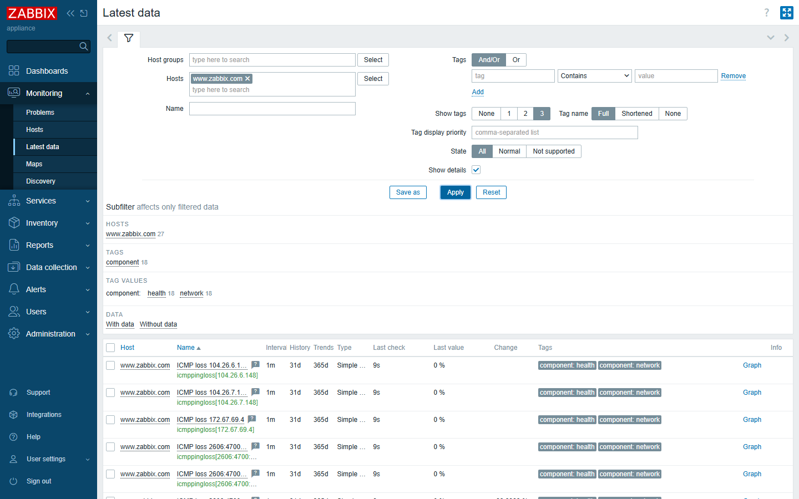
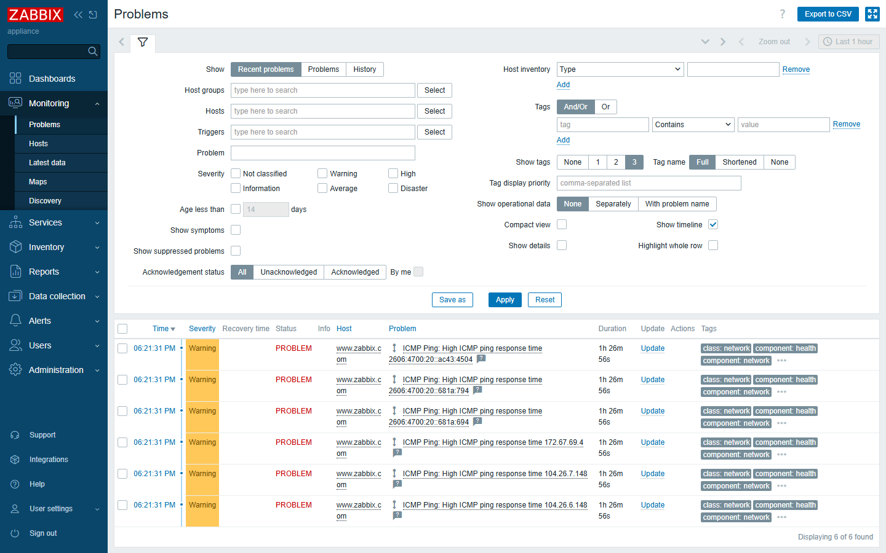

# Effects — what this template actually delivered (real demo)

This page shows the template running against a real domain, `www.zabbix.com`, on a
live Zabbix 7.0.32 server (the bundled `examples/www.zabbix.com` host). No manual
IP list was provided — **every IP below was discovered automatically from DNS.**

---

## The domain resolves to SIX addresses

`www.zabbix.com` sits behind Cloudflare. A single `A`/`AAAA` lookup returns several
edge IPs, and different resolvers can return different ones. The template queried
four public resolvers (Google DNS over IPv4 and IPv6) for both record types and
de-duplicated the result into **6 unique IPs**:

| # | IP | Family |
|---|---|---|
| 1 | `104.26.6.148`     | IPv4 |
| 2 | `104.26.7.148`     | IPv4 |
| 3 | `172.67.69.4`      | IPv4 |
| 4 | `2606:4700:20::681a:694` | IPv6 |
| 5 | `2606:4700:20::681a:794` | IPv6 |
| 6 | `2606:4700:20::ac43:4504`| IPv6 |

For **each** of those, Zabbix auto-created three items:

```
icmpping[<IP>]        → Up / Down
icmppingloss[<IP>]    → packet-loss %
icmppingsec[<IP>]     → response time (s)
```

That's **18 ICMP items** created from a single hostname — with zero manual config.



---

## It caught real problems a single-IP check would miss

During the capture, several IPs breached the latency threshold:

| IP | Observed response time | Trigger fired |
|---|---|---|
| `104.26.7.148` | **175 ms** | `High ICMP ping response time` (Warning) |
| `172.67.69.4`  | **183 ms** | `High ICMP ping response time` (Warning) |

These appeared in **Monitoring → Problems** as live events, while the *other* IPs
stayed green — exactly the partial-degradation scenario this template exists to
surface.



---

## Why this matters

- A classic "ICMP Ping" template bound to one IP would have reported **green** the
  whole time, because at least one IP was healthy.
- A DNS-round-robin / CDN / anycast service is only as healthy as its *worst* edge
  node. `ICMP Ping DNS` makes the worst node visible.
- Because discovery is **DNS-driven**, if Cloudflare rotates the IP set tomorrow,
  Zabbix picks up the new addresses automatically — no template edit, no manual
  inventory.

---

## Reproduce it yourself

1. Import `templates/ICMP Ping DNS.yaml`.
2. Import `examples/www.zabbix.com.yaml` (or create a host named after any
   multi-homed domain and link the template).
3. Wait one cycle and open **Monitoring → Latest data**.

Back to [README](../README.md) · [Usage →](usage.md)
