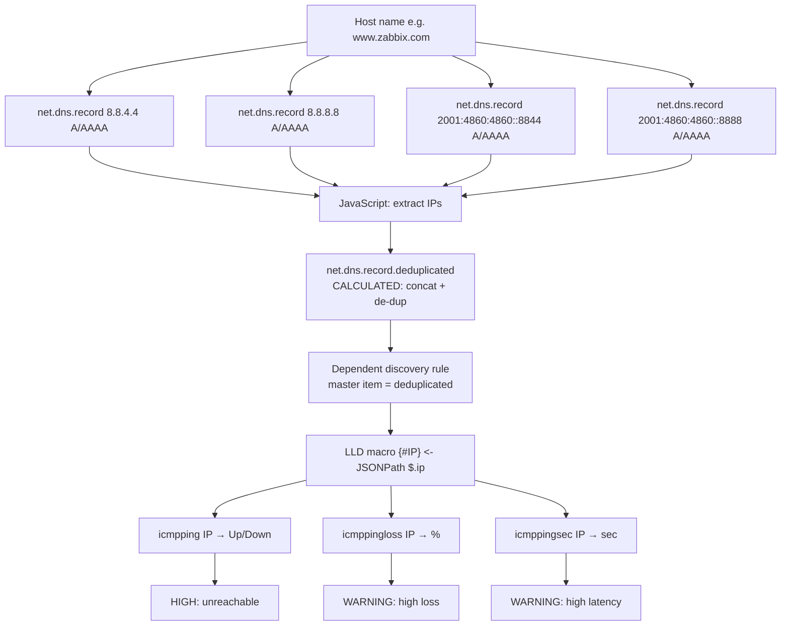
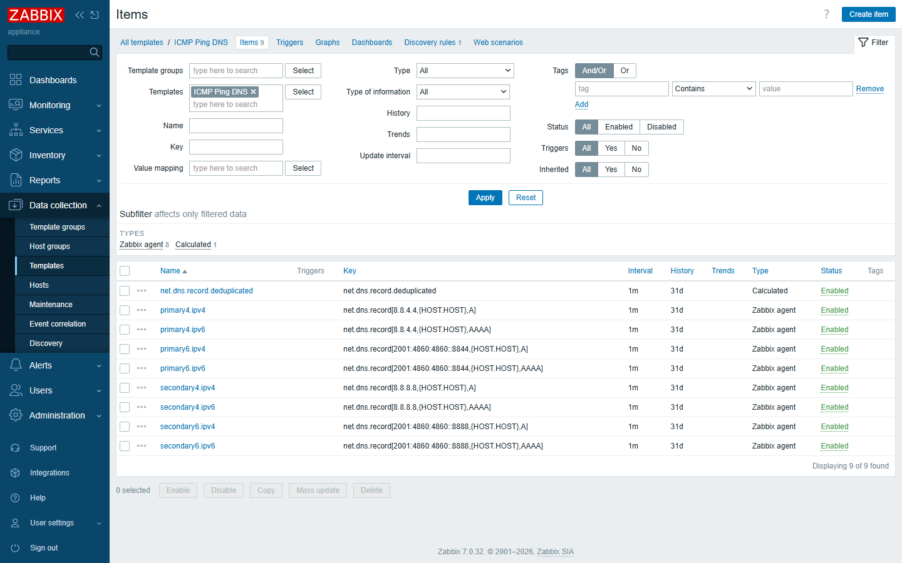
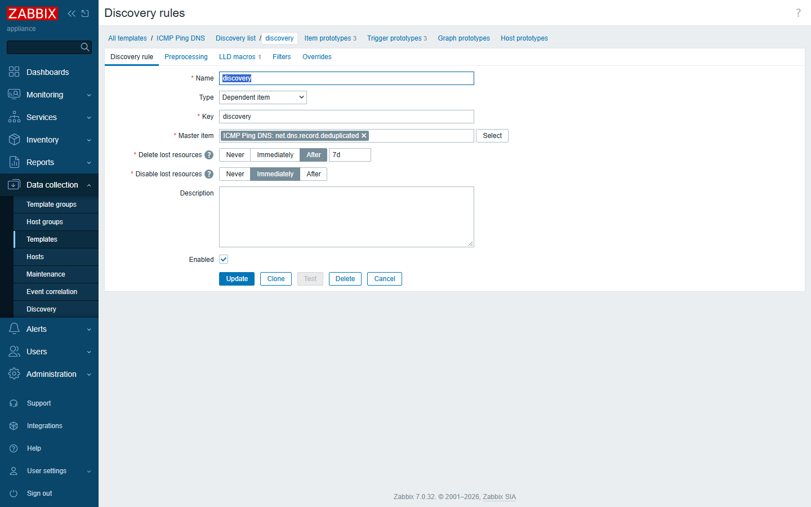
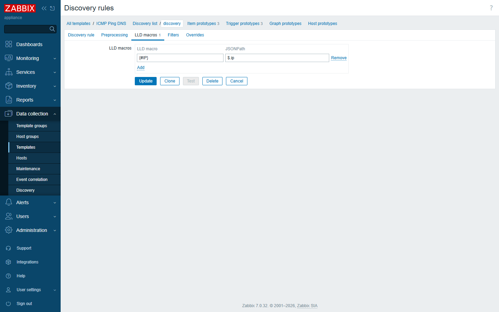
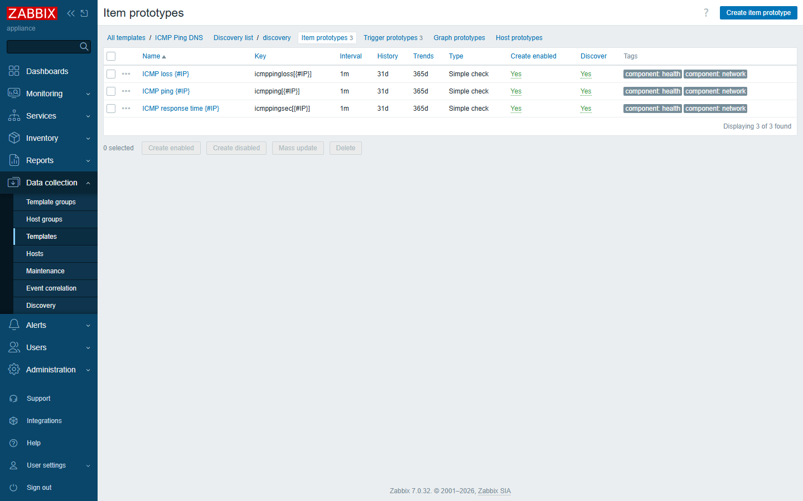

# Implementation — how `ICMP Ping DNS` actually works

This document walks through every building block of the template, with screenshots
taken from a live Zabbix 7.0 server. Read it together with
[`usage.md`](usage.md) (how to deploy) and [`effects.md`](effects.md) (what it
produces on a real host).

---

## 1. The big picture



The core idea: **DNS is the inventory source.** Instead of telling Zabbix *which*
IPs to ping, we let the DNS system tell Zabbix *which* IPs exist right now.

---

## 2. The DNS query items (8 of them)

Eight regular items each call the built-in Zabbix key
`net.dns.record[<resolver>,{HOST.HOST},<type>]` against a different public DNS
resolver and record type:

| Item name | Key |
|---|---|
| `primary4.ipv4`  | `net.dns.record[8.8.4.4,{HOST.HOST},A]` |
| `primary4.ipv6`  | `net.dns.record[8.8.4.4,{HOST.HOST},AAAA]` |
| `secondary4.ipv4`| `net.dns.record[8.8.8.8,{HOST.HOST},A]` |
| `secondary4.ipv6`| `net.dns.record[8.8.8.8,{HOST.HOST},AAAA]` |
| `primary6.ipv4`  | `net.dns.record[2001:4860:4860::8844,{HOST.HOST},A]` |
| `primary6.ipv6`  | `net.dns.record[2001:4860:4860::8844,{HOST.HOST},AAAA]` |
| `secondary6.ipv4`| `net.dns.record[2001:4860:4860::8888,{HOST.HOST},A]` |
| `secondary6.ipv6`| `net.dns.record[2001:4860:4860::8888,{HOST.HOST},AAAA]` |

> Using **two IPv4 + two IPv6 resolvers** gives resilience (one resolver
> temporarily failing won't blank out your inventory) and a broader view of what
> the world sees for that name.

### Preprocessing on each DNS item
1. **Check if unsupported** — `CHECK_NOT_SUPPORTED` with error handler
   `CUSTOM_VALUE` so a resolver that returns nothing degrades gracefully instead
   of breaking the chain.
2. **JavaScript** — extract only the IP addresses:

   ```js
   var r=[];value.replace(/\b(?:A|AAAA)\s+([\da-f:.]+)/g,function(_,ip){r.push({ip:ip});});return JSON.stringify(r);
   ```

   This turns e.g. `A 104.26.6.148\nAAAA 2606:4700:20::681a:694` into
   `[{"ip":"104.26.6.148"},{"ip":"2606:4700:20::681a:694"}]`.



---

## 3. The calculated "de-duplicated" item (the secret sauce)

`net.dns.record.deduplicated` is a **CALCULATED** item whose formula concatenates
the last values of all eight DNS items:

```text
concat(
  last(/{HOST.HOST}/net.dns.record[8.8.4.4,{HOST.HOST},A]),
  last(/{HOST.HOST}/net.dns.record[8.8.4.4,{HOST.HOST},AAAA]),
  ... 8 items total ...
)
```

### Preprocessing chain
1. `STR_REPLACE` — replace `[]` (empty arrays) with nothing.
2. `STR_REPLACE` — replace `][` (array joins) with `,`.
3. `JAVASCRIPT` — parse the combined JSON and **remove duplicate IPs**:

   ```js
   var s={};return JSON.stringify(
     JSON.parse(value).filter(function(o){return !s[o.ip] && (s[o.ip]=1);})
   );
   ```

The result is a clean JSON array of unique IPs, e.g.
`[{"ip":"104.26.6.148"},{"ip":"172.67.69.4"}, ...]` — this is what feeds discovery.


---

## 4. The dependent Low-Level Discovery rule

A **discovery rule** named `discovery` of type **Dependent item** uses
`net.dns.record.deduplicated` as its **master item**. That means Zabbix runs the
discovery off the already-collected de-duplicated list — no extra polling.

### LLD macro path
The single LLD macro maps the discovery output to `{#IP}`:

| LLD macro | JSONPath |
|---|---|
| `{#IP}` | `$.ip` |




So every object in the JSON array becomes a discovered entity with its own `{#IP}`.

---

## 5. The three item prototypes

For each `{#IP}` Zabbix creates:

| Prototype | Key | Type | Unit | Notes |
|---|---|---|---|---|
| `ICMP ping {#IP}` | `icmpping[{#IP}]` | Simple check | — | value map `Service state` (0→Down, 1→Up) |
| `ICMP loss {#IP}` | `icmppingloss[{#IP}]` | Simple check | `%` | packet-loss percentage |
| `ICMP response time {#IP}` | `icmppingsec[{#IP}]` | Simple check | `s` | latency in seconds |

All three are `Simple check` items executed by the Zabbix server/proxy (the
monitored host needs **no agent**).



---

## 6. Triggers & dependencies

Three trigger prototypes fire per IP:

| Trigger | Priority | Expression (simplified) |
|---|---|---|
| `Unavailable by ICMP ping {#IP}` | **High** | `max(/ICMP Ping DNS/icmpping[{#IP}],3)=0` |
| `High ICMP ping loss {#IP}` | Warning | `min(/.../icmppingloss[{#IP}],5m)>{$ICMP_LOSS_WARN} and <100` |
| `High ICMP ping response time {#IP}` | Warning | `avg(/.../icmppingsec[{#IP}],5m)>{$ICMP_RESPONSE_TIME_WARN}` |

**Dependencies** are wired so a completely dead IP raises only the *Unavailable*
alert:
- *High loss* depends on *Unavailable*
- *High latency* depends on both *High loss* and *Unavailable*

This prevents an alert storm when a whole IP goes dark.

---

## 7. Macros & value map

| Macro | Default | Meaning |
|---|---|---|
| `{$ICMP_LOSS_WARN}` | `20` | packet-loss warning threshold (%) |
| `{$ICMP_RESPONSE_TIME_WARN}` | `0.15` | avg latency warning threshold (s) |

**Value map** `Service state`: `0 → Down`, `1 → Up`.

Override either macro at the host or template level to tune sensitivity.

---

## 8. Why Dependent + Calculated?

- **Dependent discovery** means discovery costs *zero* extra polls — it rides on
  the DNS items you already collected.
- **Calculated de-dup** means even if two resolvers return the same IP (they
  usually do), you monitor it exactly once.
- The design scales with the DNS answer: add an IP to your LB, Zabbix starts
  monitoring it within one polling cycle — no template edit required.

---

Next: [Usage →](usage.md) · [Effects on a real host →](effects.md)
