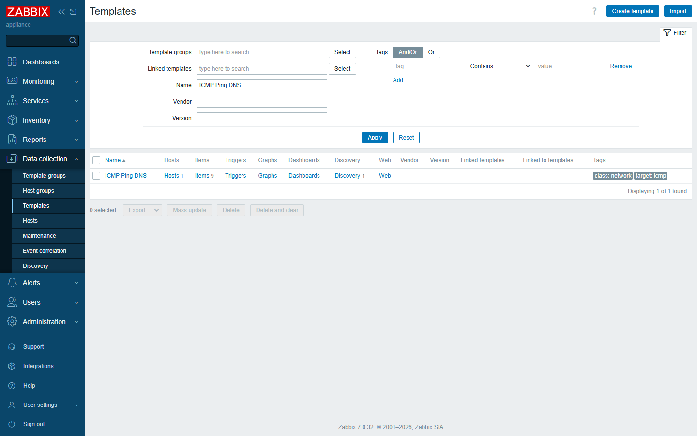
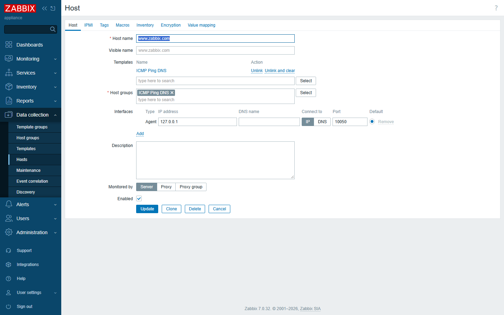
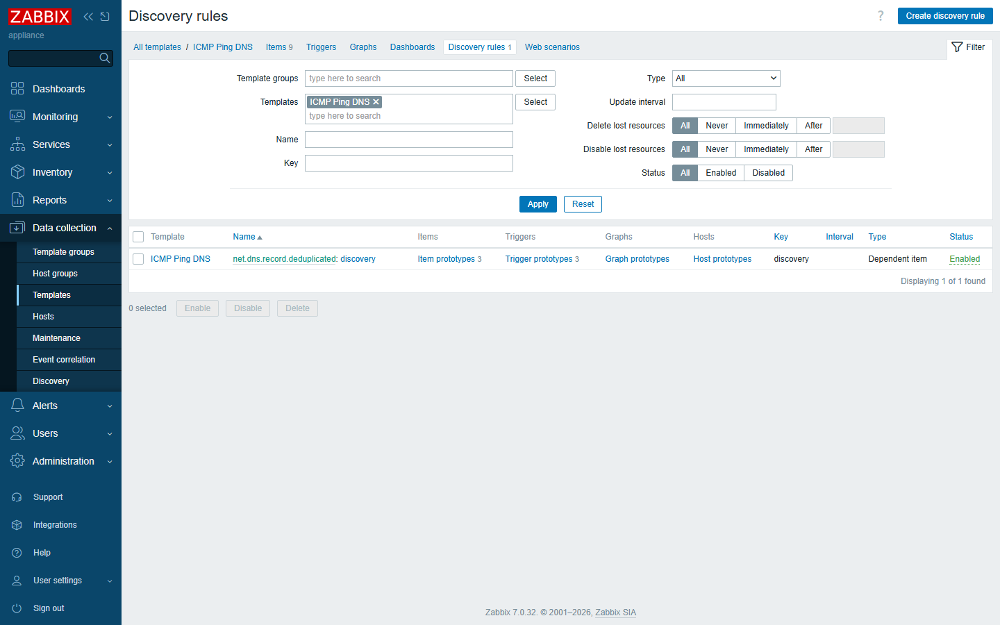
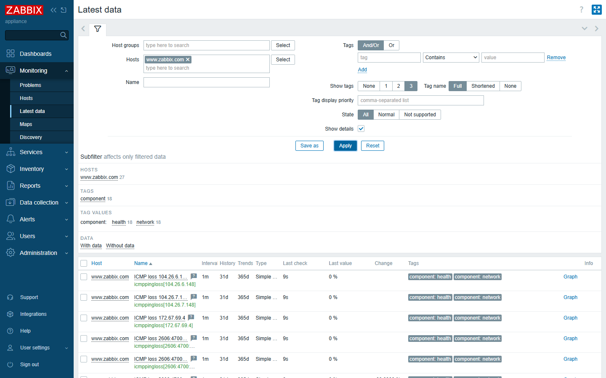
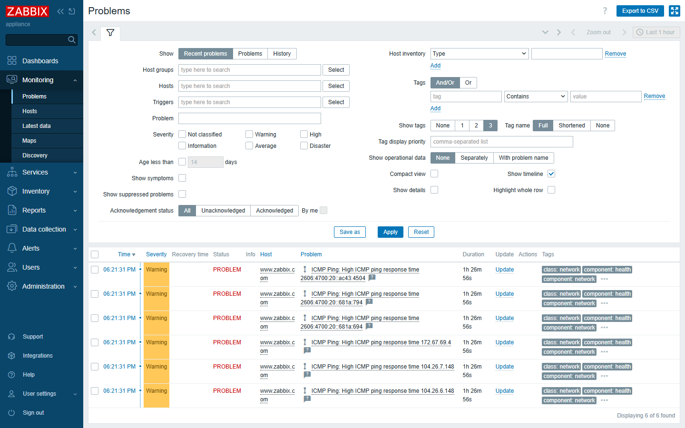

# Usage — deploy `ICMP Ping DNS` in 5 minutes

A hands-on walkthrough. All screenshots are from a real Zabbix 7.0 server.

---

## Step 0 — Prerequisites

- A Zabbix **server or proxy running 7.0**.
- That server/proxy can:
  - reach the public DNS resolvers `8.8.4.4`, `8.8.8.8`,
    `2001:4860:4860::8844`, `2001:4860:4860::8888`; and
  - send ICMP (ping) to the discovered IPs (no firewall blocking).
- The host you monitor must be **named by its DNS name** (e.g. `www.zabbix.com`),
  because the template uses `{HOST.HOST}` as the domain to resolve.

No Zabbix agent is required on the monitored host — DNS and ICMP are performed by
the Zabbix server/proxy.

---

## Step 1 — Import the template

1. Download `templates/ICMP Ping DNS.yaml` (XML/JSON also provided).
2. In Zabbix go to **Configuration → Templates** and click **Import** (top-right).

   

3. Choose the file and click **Import**. You'll get a green "Imported successfully"
   message. The template `ICMP Ping DNS` now lives under *Templates/Network
   devices*.

---

## Step 2 — Create / pick a host

The host's **Host name** must equal the domain you want to monitor.

1. **Configuration → Hosts → Create host**.
2. Set **Host name** = `www.zabbix.com` (your real domain).
3. Add any interface (even a dummy `127.0.0.1` works, because the template does
   server-side DNS + ICMP, not agent checks). Assign it to a host group.
4. Switch to the **Templates** tab → **Select** → choose `ICMP Ping DNS` →
   **Add** → **Update**.

   

> The bundled `examples/www.zabbix.com.*` file already does this for you — import it
> as a host if you just want the demo.

---

## Step 3 — Wait for discovery

Within one polling cycle the dependent discovery rule runs:

1. The 8 DNS items resolve the host against the 4 resolvers (A + AAAA).
2. `net.dns.record.deduplicated` collates & de-duplicates the IPs.
3. The `discovery` LLD rule creates **one set of three ICMP items per unique IP**.

You can watch it happen under **Configuration → Hosts → your host → Discovery**.

---

## Step 4 — See it live

Go to **Monitoring → Latest data**, filter by your host, and expand **Show
details**. You'll see every resolved IP with its ping state, loss % and response
time:

Each `icmpping[...]` shows `Up`/`Down` thanks to the `Service state` value map.

---

## Step 5 — Tune thresholds (optional)

The defaults are `{#ICMP_LOSS_WARN}=20` (%) and
`{$ICMP_RESPONSE_TIME_WARN}=0.15` (s). To change them for one host only, open the
host → **Macros** tab and override the macro. To change globally, edit the template's
macros.

---

## Step 6 — Get alerted

When an IP goes unreachable, or loss/latency crosses the threshold, a problem is
raised:

Wire these to your normal notification media (email, Slack, etc.) like any other
Zabbix trigger.

---

## Troubleshooting

| Symptom | Cause / fix |
|---|---|
| No discovered items | Host name isn't a real domain, or the Zabbix server can't reach the DNS resolvers. Check `net.dns.record[...]` items in Latest data. |
| DNS items "Unsupported" | Firewall blocks outbound DNS from the Zabbix server, or resolver IP changed. The `CHECK_NOT_SUPPORTED` handler keeps the template alive. |
| All IPs "Down" but reachable | Zabbix server itself can't send ICMP (often a cloud/container network restriction). Test `fping`/`ping` from the server. |
| Duplicate items | Shouldn't happen — the de-dup step removes them. If you see duplicates, re-import the template. |

Back to [Implementation →](implementation.md) · [Effects →](effects.md)
